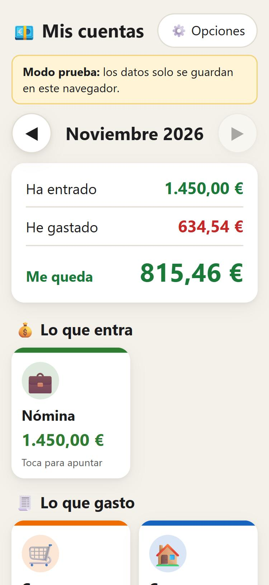
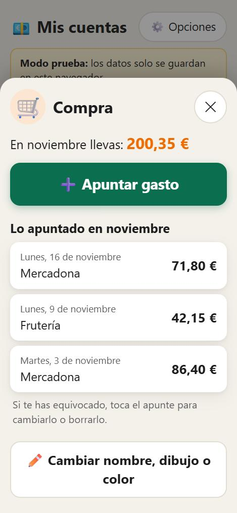
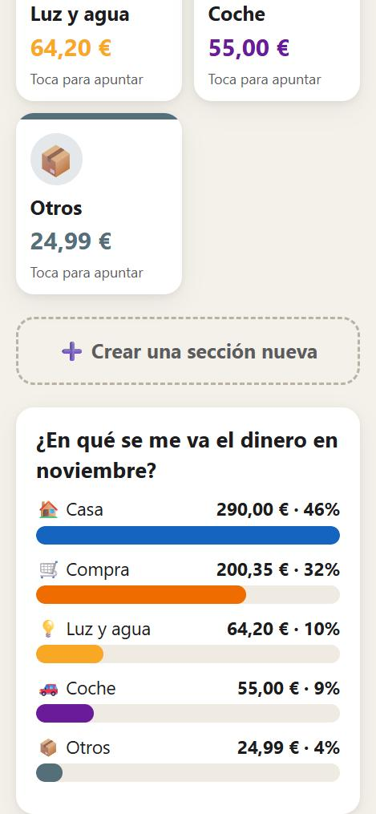
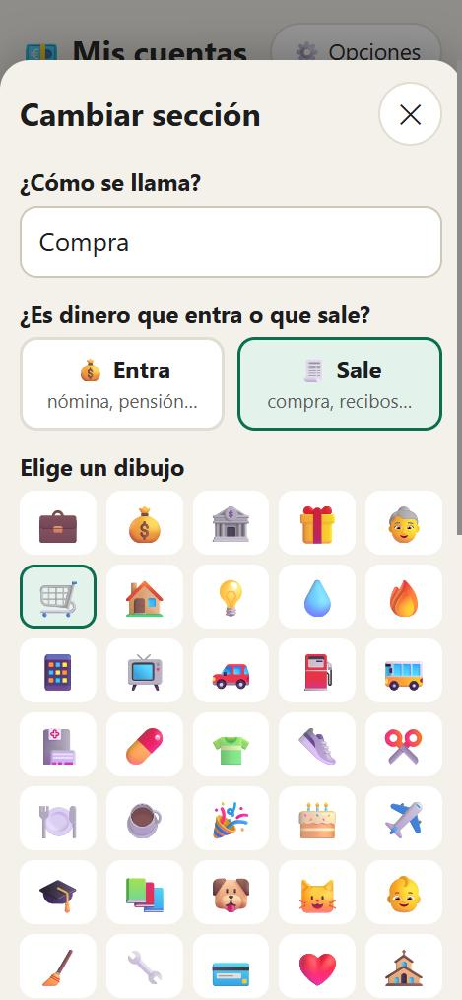

<div align="center">


# Mis cuentas

**App web instalable para apuntar ingresos y gastos por secciones y ver, mes a mes, cuánto queda.**

Diseñada para una usuaria real: mi madre, que no está acostumbrada a la tecnología.

[](https://miscuentas-6ba18.web.app/?demo)


</div>

---

<div align="center">




</div>

## El problema

Mi madre quería llevar la cuenta de lo que entra (la nómina) y de lo que gasta (la compra, la casa, la luz…), pero las apps de finanzas que hay son demasiado complejas para ella: menús escondidos, gráficos densos, cuentas bancarias que conectar...

El objetivo era una herramienta que pudiera usar **sola, sin ayuda**, desde el móvil y desde el ordenador.

## Qué hace

- **Resumen del mes en grande:** lo que ha entrado, lo que se ha gastado y lo que queda, en verde o en rojo.
- **Secciones propias:** ella crea las suyas (nombre, dibujo, color, y si es ingreso o gasto).
- **Apuntar en tres toques:** tocar la sección, escribir la cantidad y guardar.
- **Historial por meses** y gráfico de *"¿en qué se me va el dinero?"*.
- **Corregir sin miedo:** cualquier apunte se puede cambiar o borrar, siempre con confirmación.
- **Exportar a Excel** (CSV con formato español).
- **Varias personas:** cada una entra con su cuenta de Google y solo ve sus datos.

## Decisiones de diseño

Pensadas para una persona mayor poco habituada a las apps:

- **Letra de 19 px y botones de 56 px o más**, alto contraste, y textos en lenguaje cotidiano ("Me queda", "Lo que gasto") en vez de jerga financiera.
- **Sin menús ocultos ni gestos:** todo está a la vista y se hace tocando.
- **El botón "atrás" de Android cierra la ventana abierta** en lugar de salir de la app (las ventanas se apilan en el `history` del navegador).
- **Entrada de importes tolerante:** acepta `12,50`, `12.5` o `1.450,30`.
- **Entrar con Google** para no tener que recordar otra contraseña.

## Arquitectura

```
index.html · styles.css    Interfaz (HTML/CSS sin frameworks)
app.js                     Pantallas, ventanas y lógica de la UI
store.js                   Capa de datos con dos implementaciones:
                             · modo demo  → localStorage
                             · modo real  → Firebase Auth + Firestore
sw.js · manifest.json      PWA: instalable y funciona sin conexión
firestore.rules            Cada usuario solo puede leer/escribir lo suyo
```

- **Sin paso de build:** JavaScript con módulos ES nativos; el SDK de Firebase se carga desde su CDN solo cuando hace falta.
- **Importes en céntimos enteros**, para que las sumas no arrastren errores de coma flotante.
- **Caché persistente de Firestore:** la app abre al instante y permite apuntar sin cobertura; se sincroniza sola al recuperar la conexión.
- **Datos por usuario** en `users/{uid}/sections` y `users/{uid}/entries`, protegidos por reglas de seguridad.
- **Modo demo** con `?demo` en la URL: datos de ejemplo en el navegador, sin cuenta ni conexión con la base de datos.

## Probarla en local

```bash
python -m http.server 8080
```

Abre http://localhost:8080/?demo. Para montar tu propio proyecto de Firebase y publicarla, sigue [LEEME.md](LEEME.md).
